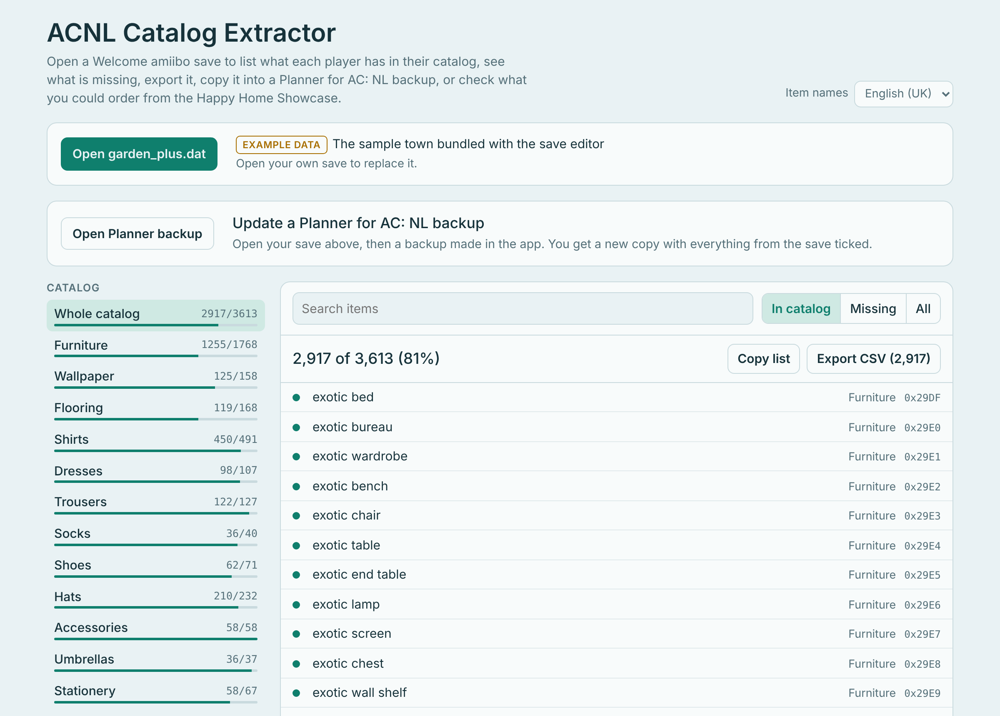

# 🍃 ACNL Catalog Extractor

**See everything in your Animal Crossing: New Leaf catalog, and send it straight to Planner for AC: NL.**

[**▶ Open the tool**](https://cant-press.github.io/acnl-catalog-extractor/)

---

## ✨ What it does

Open your `garden_plus.dat` and the page reads each player's catalog straight from the save.

- 📖 **Browse your whole catalog** by category: furniture, wallpaper, flooring, clothing, songs, gyroids, fossils, stationery and more
- 🔍 **Find what's missing**, with search and "In catalog / Missing / All" filters
- 💎 **Check rare items**: distributed (SpotPass and Nintendo Zone), Club Tortimer, and Japan-only RV items, with where the obtainable ones can still be bought
- 🏠 **Search the Happy Home Showcase**: see everything on display in your showcase houses, who owns each house, and what you could order that isn't in your catalog yet
- 📋 **Copy or export** any list as a CSV
- 🗓️ **Fill in Planner for AC: NL**: update a backup from the app so it ticks everything your save shows

## 🏠 Happy Home Showcase

Open `exhibition.dat`, which sits next to `garden_plus.dat` in your backup, and the tool lists every piece of furniture, wallpaper and flooring on display in your showcase houses. Each item shows which houses have it, whether it's already in your catalog, and whether it's one of the rare items above, so you can spot distributed items like the zodiac furniture that you can still order from a showcase house.

> [!NOTE]
> You can order up to 5 items a day from the showcase. Some items can't be ordered at all, such as the mermaid set and the turkey, and the save doesn't record which ones, so check in the game.

## 🗓️ Exporting to Planner for AC: NL

Open your save, then a backup exported from the app. The page shows what it will add before you download anything, and gives you a **new** backup file. Your original is left alone.

| Planner list | Filled from your save |
|---|---|
| Bugs, fish and sea creatures | ✅ Everything you've caught |
| Furniture, wardrobe, wallpaper and flooring | ✅ Your catalog |
| Songs, gyroids, fossils, art and photos | ✅ Your catalog |
| Misc (fruit, flowers, shells, tools, stationery…) | ✅ Your catalog |
| Museum donations | ✅ The town museum |
| Villagers | ✅ Current residents |
| Emotions and badges | ✅ The player you choose |
| Public Works Projects | ✅ Projects standing in town now |
| House exterior | ⚠️ Current exterior only |

Every name the tool writes was checked against a full export from the app, so items show up ticked rather than silently skipped.

> [!NOTE]
> **Villagers** and **Misc** are *replaced* with what your save holds, so manual ticks in those two lists are removed when you sync. Every other list only adds ticks and never removes your own.

### Things you'll still need to tick by hand

The save doesn't record these in a way the tool can read:

- House style and special doors (mansion, castle, arched door…)
- "Default" town hall and train station renovations
- Past house exteriors, since only the current one is saved
- amiibo cards
- `puffoid` and `spunky knit shirt`, which the app lists but don't appear in the game's item data

## 🚀 How to use it

1. **Get your save.** On a modded 3DS, back up New Leaf with [Checkpoint](https://github.com/BernardoGiordano/Checkpoint) or JKSV, then copy `garden_plus.dat` from the backup folder on your SD card.
2. **Open the tool** and choose **Open garden_plus.dat**. Pick a player if your town has more than one.
3. *(Optional)* **Happy Home Showcase:** choose **Open exhibition.dat** from the same backup folder.
4. *(Optional)* **Planner for AC: NL:** export a backup from the app, choose **Open Planner backup**, check the summary, then **Download updated backup**.
5. **Restore** the downloaded file in the app.

> [!IMPORTANT]
> Keep your original Planner backup somewhere safe before restoring, so you can go back if anything looks wrong.

## 🔒 Privacy

Everything happens in your browser. Your save, showcase and backup files are **never uploaded**, and your save is **never modified**. The tool only reads it.

## ❓ FAQ

<b>Does it work with an old <code>garden.dat</code>?</b>

No. Only saves with the Welcome amiibo update (`garden_plus.dat`) are supported, because the update changed the item numbers. Once a game is updated it uses `garden_plus.dat`, even if an old `garden.dat` is still in the folder.

<b>Will it work with the iOS version of Planner?</b>

Possibly, but it's only been tested with the **Android** app. If you try it on iOS, please open an issue and say how it went.

<b>My catalog shows 100% but I never collected everything</b>

If the catalog was ever filled with a save editor, the save marks every item as collected, so the tool shows it that way too.

<b>Where do the showcase houses come from?</b>

They're the houses the game has saved from StreetPass and the Happy Home Network. Some are placeholder houses named "Someone (Anytown)". Empty showcase slots are skipped.

<b>Something isn't ticked that should be</b>

Please [open an issue](../../issues) with the item name and the list it's in.

## ⚠️ Disclaimers

> [!WARNING]
> **This project was vibe coded with [Claude](https://claude.ai).** I described what I wanted and tested it against my own save and the Planner app. Claude wrote the code and worked out the save format from existing open-source tools. It's been checked carefully, but it hasn't been reviewed line by line by an experienced developer, so treat it as a hobby project and keep backups.

- Unofficial fan project. **Not affiliated with or endorsed by Nintendo, or by the developer of Planner for AC: NL.**
- *Animal Crossing* is a trademark of Nintendo.
- Tested on one save and the Android version of Planner for AC: NL. Your results may vary.

## 🙏 Credits

- **[ACNL Save Editor](https://github.com/marcrobledo/acnl-editor)** by Marc Robledo: item names, IDs and save layout (MIT licence)
- **[Nookipedia](https://nookipedia.com)**: distributed and unobtainable item lists, RV sellers, badge and emotion names
- **[ACNL_ID_Lists](https://github.com/RedShyGuy/ACNL_ID_Lists)** by RedShyGuy: emotion IDs
- **[Vapecord ACNL Plugin](https://github.com/RedShyGuy/Vapecord-ACNL-Plugin)**: item category ranges and the catalog bitfield layout
- **[Planner for AC: NL](https://csvensson.app/planner-acnl/)** by C Svensson Apps: the companion app this tool exports to. Go and get it if you don't have it! This tool isn't made by or affiliated with its developer.

---

Made with 🍃 for the New Leaf community

